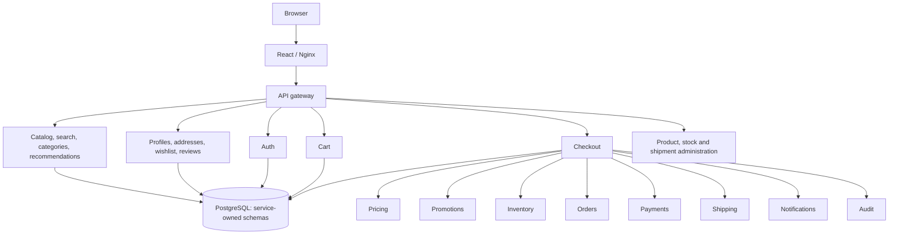

# Architecture

React/Vite produces a static frontend served by unprivileged Nginx. Nginx forwards same-origin `/api` requests to the gateway. The gateway validates the opaque session against auth, derives user identity itself, enforces admin roles and order ownership, and calls internal domain APIs. All other backend Services are ClusterIP-only and require the internal service token.

## Runtime boundaries

There are exactly 20 independent backend Deployments and Services, plus frontend Deployment/Service and PostgreSQL StatefulSet/headless Service. To keep the code small, backend services share an image, bootstrap, HTTP client, store adapter and typed contracts. `SERVICE_NAME` registers only that service's routes; each container runs one service and has a distinct database role. Independent deployments can restart or scale separately. The shared image is an intentional development simplification.

Requests use HTTP/JSON with five-second downstream timeouts. The gateway does not trust user IDs in browser payloads. An internal shared token authenticates service traffic within this local test cluster. Sessions are HTTP-only, SameSite Strict cookies; enable `COOKIE_SECURE=true` when introducing HTTPS. Only synthetic demo users exist, and demo credentials are intentionally documented.

Each response includes a server-generated request ID and each process emits structured Fastify logs. Request IDs are local to each service hop; distributed tracing is not included. Health endpoints are `/health/live` and `/health/ready`. Readiness verifies access to the service's own database schema; liveness does not depend on downstream services. API process shutdown drains the HTTP server and closes the database pool.

## Database ownership

One PostgreSQL database contains a schema and login role per backend service. Application roles can access only their own schema. Migration and seed Jobs use an administrator connection; runtime services do not. Stateless services retain an empty schema so readiness verifies the same connection and migration precondition consistently.

Each schema has a `records(collection, id, value JSONB)` table with a composite primary key. Domain records remain validated and typed in the application. This intentionally small document-style schema avoids dozens of migrations while preserving persistence and service ownership. It is suitable for this small dataset, not an optimized analytics or large-commerce data model. Lists are read into memory and filtered at the service boundary.

Writes that need atomicity use PostgreSQL transactions with transaction-scoped advisory locks. Inventory uses one stock lock across reservations/admin stock changes. Cart and wishlist lock per shopper. Cross-service references are IDs; no cross-schema queries or foreign keys. Pool size is four connections per service, keeping the 20-service total below the default PostgreSQL connection budget.

## Purchase coordination

1. Persist a checkout intent under a shopper-scoped idempotency key, including product/price/address snapshots and a fingerprint of checkout options.
2. Acquire a persisted execution lease. Duplicate active attempts return 409 and should retry with the same key. A crashed process's lease expires after two minutes.
3. Save a pending order and reserve all stock atomically. Inventory reservation keys use the order ID.
4. Call the simulated payment endpoint with the same order ID. Repeated calls return the original outcome, including when the first response was lost.
5. On approval, commit stock and persist the paid order. On decline or stock failure, release reservations and persist a failed order.
6. Remove purchased quantities from the cart once, create a shipment once, persist a notification once, and record an audit event under a stable ID.

Progress is autocommitted between calls; external calls never run inside a long database transaction. A 15-second recovery loop resumes incomplete intents. Reservations for intents that expire before reaching the reserved phase are released during recovery. Once a reservation is durably recorded, recovery settles its idempotent payment and then commits or releases it; it never expires stock underneath an ambiguous payment result. Reservation records carry a five-minute expiry; checkout owns reconciliation, so inventory has no independent sweep that could race a charge.

A payment decline returns 409; the shopper can start a new attempt using a new key. Temporary dependency failures return an error while the intent remains recoverable. Shipment or notification failure after payment leaves the order paid, and recovery retries those steps. A shopper can check order history while recovery finishes. A retry with the original key returns the original order; reusing that key with different address/coupon/payment choices returns 409. The key deliberately refers to the first cart snapshot.

This is a small persisted workflow, not a distributed transaction or a general saga engine. It depends on the checkout recovery loop running again after an outage. It does not include external payment webhooks, partial fulfillment, cancellation or returns.

## Scope and limits

All external effects are synthetic. Product graphics use built-in emoji and CSS rather than downloaded product images. Admin product edits update catalog, pricing, and inventory through separate APIs; a partial downstream failure can leave a partial edit, which the admin can retry. There is no cross-service transaction for those demo administration operations. Audit availability can also cause an admin operation to report an error after its primary update succeeded.

No message broker, cache, search cluster, ingress controller, full observability stack, autoscaler, or production database HA is needed for the functional test scope. Each service is still independently addressable and deployable for Kubernetes experiments.
